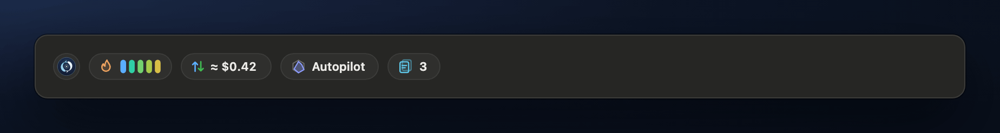
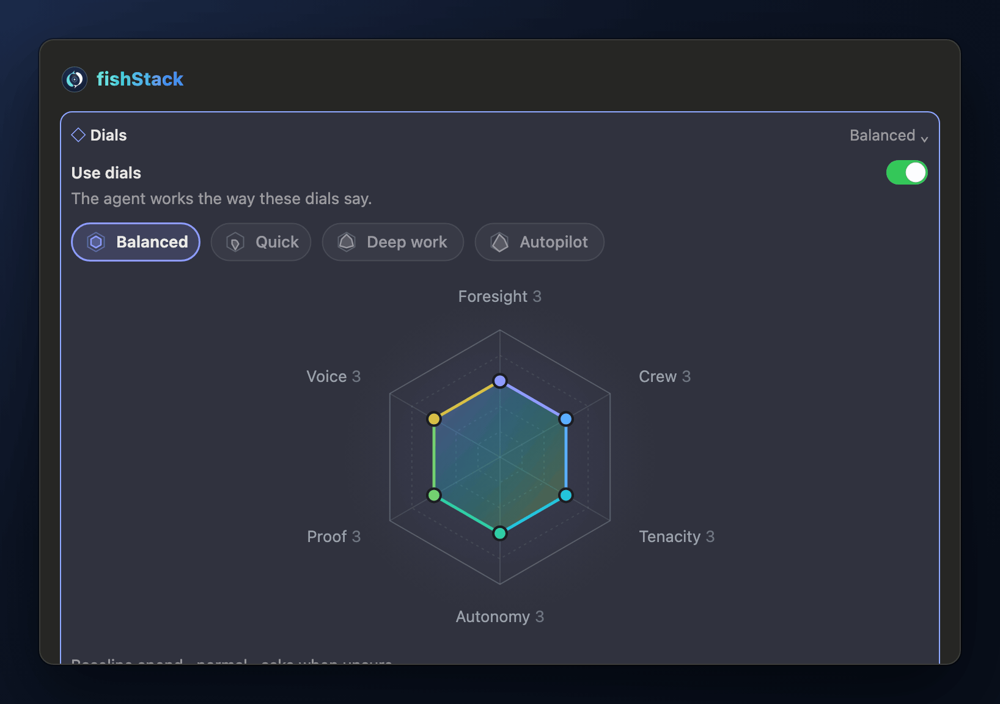
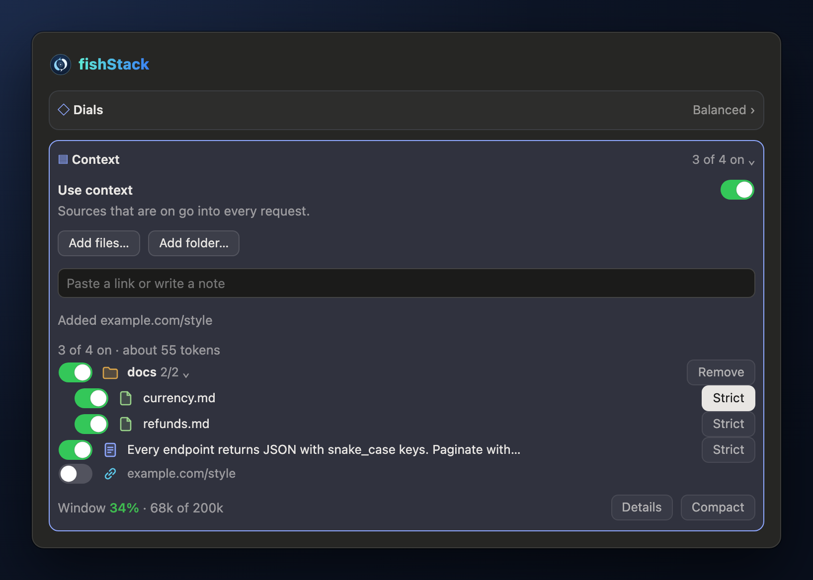

<p align="center">
  
</p>

<h1 align="center">fishStack</h1>

<p align="center">
  <b>A Claude Code plugin: a working style you set once,<br>
  and notes the agent always reads.</b>
</p>

<p align="center">
  <a href="https://www.npmjs.com/package/claude-fish-stack-mod"></a>
  <a href="LICENSE"></a>
  
</p>

<p align="center">
  
</p>

If you run Claude Code all day, a few things keep getting in the way:

- **You keep repeating yourself.** "Write a spec first." "Don't ask, just decide." "Run the tests." You type it every session.
- **The agent forgets what matters.** API conventions, the design doc, the ticket: pasted in again and again.

fishStack adds a status rail above the prompt, inside the chat: the prompt cache's heat bar, the cost, and how the agent works (`◇ Balanced`, `▤ 3 of 4 on`). Click either to open its card: on the right, beside Claude Code's own panel, where the app docks one; otherwise right under the rail, above the prompt. Each card starts with its switch (**Use dials**, **Use context**), so you can turn either off.

Every setting is kept per repository: the switches, **Enforce**, the dials, and the context library. A worktree shares its main checkout's settings; outside git, the folder has its own. A repository that hasn't set something yet starts from the value you had before settings were per repository.

| Card | What it does |
| - | - |
| **[Dials](#dials)** | Six dials set how the agent plans, delegates, persists, asks, proves and talks. Some levels are enforced in code, not only asked for. |
| **[Context](#context)** | Notes, links and files the agent reads in every request. Mark one Strict and the agent treats it as ground truth. |

## Install

In Claude Code 2.1.296 or newer:

```
/plugin marketplace add patrick-lai/claude-fish-stack-mod
/plugin install fishstack@claude-fish-stack-mod
```

Or the same from your shell:

```bash
claude plugin marketplace add patrick-lai/claude-fish-stack-mod
claude plugin install fishstack@claude-fish-stack-mod
```

Or in one step, with no `/plugin` commands:

```bash
npx -y fishstack-mod install
npx -y fishstack-mod uninstall
```

Restart Claude Code. The rail shows above the prompt. In the desktop app (and a terminal in fullscreen mode at 110 columns or more) the cards also open on the right by themselves, beside Claude Code's own panel; click a rail item, or type **`/fs dials`** (or `/fishstack dials`), to open that card there. Anywhere the cards can't sit on the right, a card opens under the rail, above the prompt.

fishStack is built and tested on macOS: the file pickers use macOS tools.

## Dials

<p align="center">
  
</p>

Six dials, each with five levels, become a short **Working style** brief in the agent's system prompt:

| Dial | 1 | 2 · 3 · 4 | 5 |
| - | - | - | - |
| **Foresight** | Dive in | Sketch · Plan steps · Write a spec | Deep spec |
| **Crew** | Solo | Scouts · Helpers · Squads | Swarm |
| **Tenacity** | One pass | Retry once · Push through · Checklist | Goal mode |
| **Autonomy** | Ask first | Check in · When unsure · Decide, note | Autopilot |
| **Proof** | Trust | Compile · Run tests · Component QA | Full QA |
| **Voice** | Silent | Terse · Normal · Explain | Teach |

Start from a preset (**Balanced**, **Quick**, **Deep work**, **Autopilot**), then nudge single dials. On the desktop you can drag the radar's points. The estimates beside the radar show what a setting costs you in spend, time to done, and how often the agent will ask you.

A change takes effect right away, even mid-turn: the agent picks it up before its next request. **What agents are told** shows the exact brief. **Use dials** off sends no working style at all, and your settings wait for you.

### Enforced, not only asked

A prompt is a request; some levels are also held in code, so the agent can't skip them. Each dial's card says what its level enforces:

| Dial | Level | Enforced |
| - | - | - |
| Foresight | Write a spec, Deep spec | The first edit of a request waits until the agent has posted its spec. |
| Crew | Solo, Scouts | Subagents are refused; at Scouts, one per request. |
| Tenacity | Checklist, Goal mode | A request that changed code ends with its checklist or acceptance criteria. |
| Proof | Compile and up | A request that changed code runs a build, typecheck or tests after its last change. |
| Voice | Explain, Teach | A request that changed code ends with the labelled parts. |
| Autonomy | Autopilot | A question nobody answers is settled after 15 minutes. |

It's built never to get in the way of Claude Code itself:
- **Capped.** An edit is refused twice at most per request, then let through, and the end of a request is held back once at most, never in a loop.
- **Main agent only.** Subagents and doc-only changes are left alone.
- **Fails open.** Any check that can't decide lets things through.
- **Switchable.** The **Enforce** switch turns it all off and leaves the dials as prompts alone.

The level prompts borrow good habits from [pStack](https://github.com/cursor/plugins/tree/main/pstack) (Lauren Tan, MIT): verdicts of VERIFIED, NOT VERIFIED or INCONCLUSIVE, a failing test before a bug fix, one done-predicate and one owner per file for parallel subagents, and testing a shared assumption after two failed fixes.

### Autopilot answers when you're away

<p align="center">
  
</p>

Autopilot is the top Autonomy level: the agent works as if you're away. It decides open questions itself, clears its own blockers, may use other apps and connected tools, and never deletes data.

If it still asks you something and nobody answers, the question isn't left hanging overnight. After 15 minutes (`autoAnswerMinutes`), Autopilot picks the option marked *(Recommended)*, or the first one. The agent is told that no person chose, and carries on.

While Autopilot waits, the dials pill on the rail turns amber with a ring that runs down, the Dials card says **Answers in N min**, and a line under the question says what it will pick. Answer yourself, or lower the dial, and nothing is picked.

## Context

<p align="center">
  
</p>

Add the things the agent should always know (**Use context** off holds them all back at once): a note, a link (fetched as text), a file, or a whole folder from **Add folder…**. Each source has an **On/Off** switch. A **Strict** source is binding: if the code disagrees, the agent has to say so. A line keeps the total near a 12k-token budget, and the card's last line shows how full the context window is.

Libraries are kept per repository and reach the agent as a **Project context** section, every request.

<p align="center">
  
</p>

## The rail

The rail is one row of pills above the prompt, and it stays one row at any window width. In the desktop app, hover a pill for details (nothing shifts). Click Dials or Context to open that card, docked on the right.

| Pill | Shows |
| - | - |
| **Mark** | Opens the Dials card, or closes the open one. |
| **Cache** | The prompt cache. Five bars run down over the five minutes after a reply. While any are lit, your next message reuses the cache, so it's faster and cheaper. Hover for the hit rate: the last reply's and the whole session's share of input read from the cache, from the token counts Claude reports. |
| **Cost** | Claude Code's own `/cost` total at API list prices, cache reads and writes included. It isn't your plan's bill. Tokens in and out on hover. |
| **Dials** | The preset, or Off. Amber while Autopilot waits to answer for you, green once it has. |
| **Context** | How many sources are on, or Off. |

In the terminal the rail is plain text, and the same items open the same cards.

## Options

Set them in `/config`. They're stored under `pluginConfigs["fishstack"].options`.

| Option | Default | What it does |
| - | - | - |
| `autoAnswerMinutes` | `15` | How long Autopilot waits before answering for you. |

<details>
<summary><b>Coming from Craftshop?</b></summary>

fishStack was called Craftshop. Its first session copies what Craftshop saved (dials, context libraries, switches) into its own store, once, and never over anything fishStack already holds. Options set under `pluginConfigs["craft-shop"]` don't carry over, so set them again in `/config`.
</details>

<details>
<summary><b>Used the Worktree card before 0.9?</b></summary>

fishStack 0.9 dropped worktrees; Claude Code's own `--worktree` and the desktop's worktree option are unaffected. The first session in a repository that had **Use worktrees** on takes fishStack's `WorktreeCreate` and `WorktreeRemove` entries out of `.claude/settings.local.json` (everything else there stays) and switches off the old desktop hook. Slots already made stay where they were, under `.claude/worktrees/fishstack/`, with their `fish/…` branches: remove the ones you don't need with `git worktree remove <path>`.
</details>

## Develop

```bash
claude plugin test .
```

That runs the tests in `tests/`, drawing the UI on both the terminal and the desktop. More:

```sh
claude plugin validate .      # manifest, marketplace and hooks module
claude --plugin-dir .         # run it; saving hot-reloads
e2e/drive.sh                  # end to end against real Claude Code in tmux
e2e/shoot.sh                  # every desktop tab, screenshotted
e2e/reel/scenes.sh            # record this README's terminal scenes from real Claude Code
e2e/reel/media.sh             # draw every picture in docs/media
```

`e2e/drive.sh` checks every feature as a person would, against a fixture repository: dials (mid-turn too) and a Strict note reach the agent, and Autopilot answers an unanswered question.

The README's media come from two places:

- **Terminal GIFs** (`autopilot`, `context`): real Claude Code with this plugin, recorded in tmux by `e2e/reel/scenes.sh`.
- **Desktop pictures** (`rail`, `dials`, the two panes): the desktop's own UI trees, drawn by the tests in `tests/media.test.ts` and `tests/desktop.test.ts` and laid out as the desktop pane. These are close to the app's own paint, not screenshots of it.

## The mark

"Moonlit": two pale koi circling a ripple on night water, a school of two. It's drawn in code in `hooks/brand.ts`, and `node e2e/brand.mjs` writes [`assets/icon.svg`](assets/icon.svg) and a one-colour menu-bar version, [`assets/icon-template.svg`](assets/icon-template.svg).

## License

[MIT](LICENSE) © Patrick Lai
